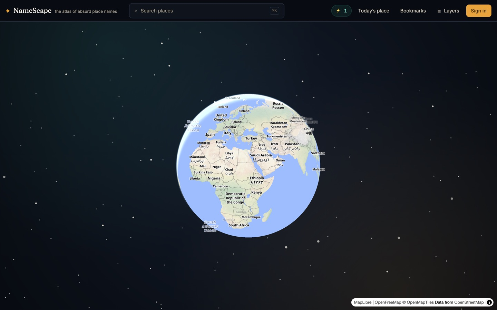
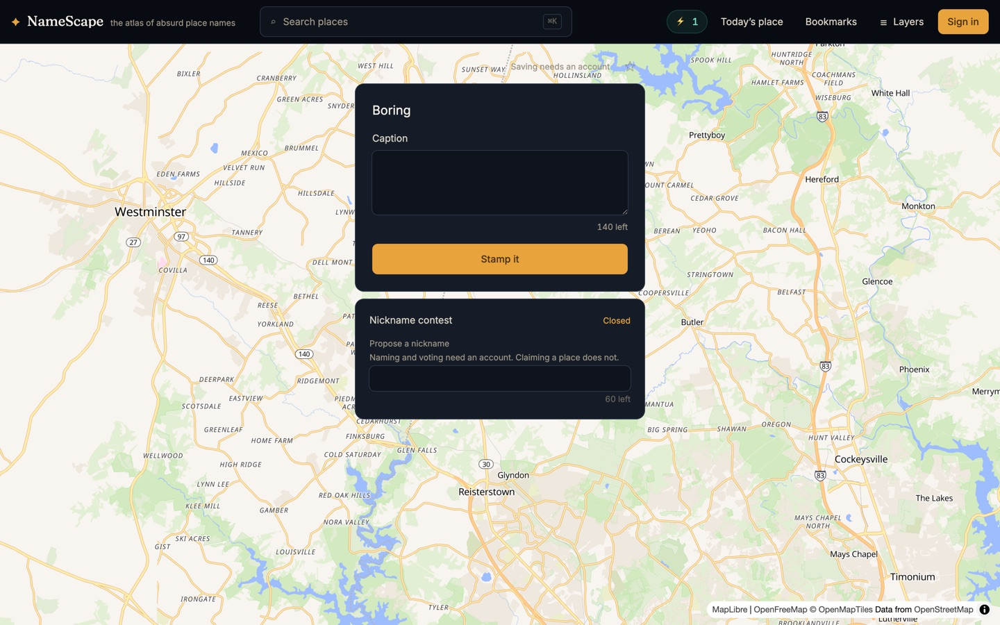
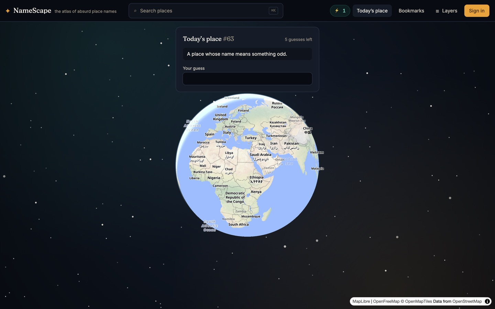
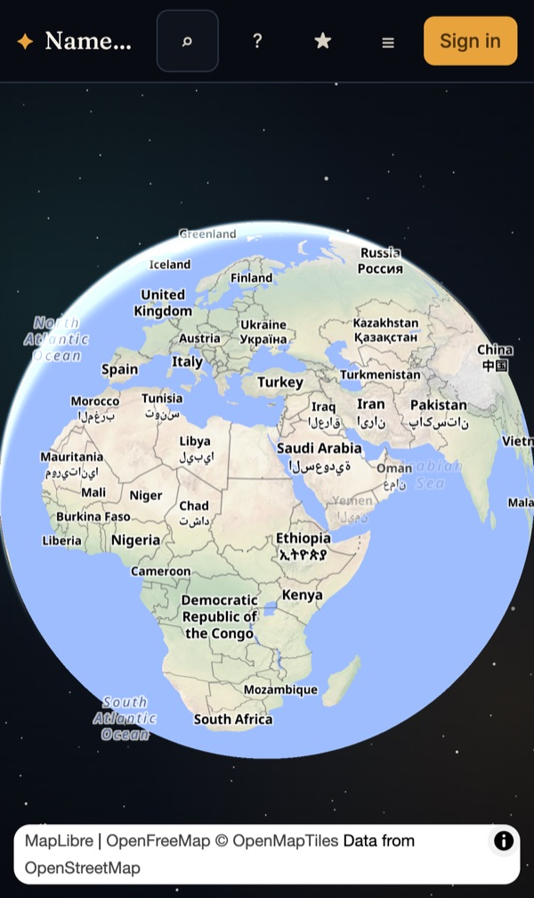
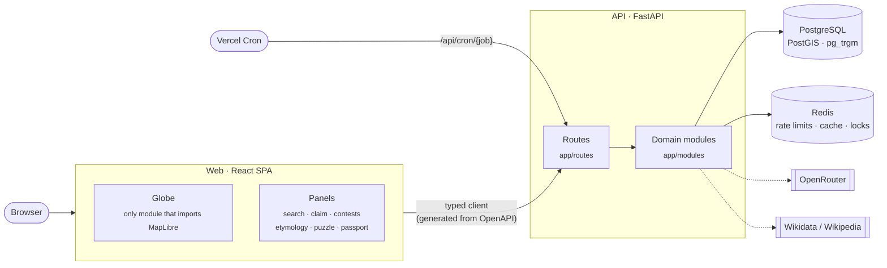
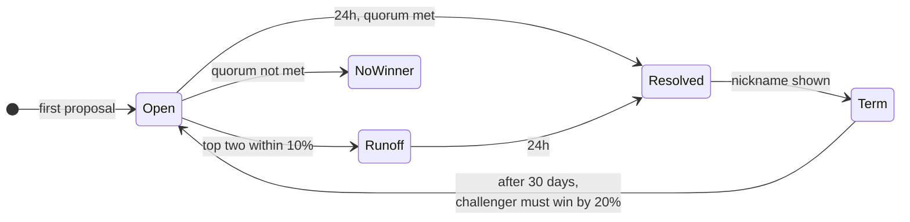
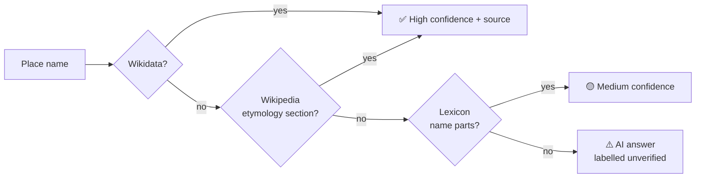

<div align="center">

# ✦ NameScape

**The atlas of absurd place names.**

Claim real places with strange names, vote on nicknames, and learn what the names really mean, all on a live 3D globe.

[**Live demo**](https://namescape.vercel.app) · [Features](#features) · [Tech stack](#tech-stack) · [Architecture](#architecture) · [Getting started](#getting-started)




</div>

---

## What it is

NameScape is a shared world map of real places with funny or surprising names, such as Boring, Oregon.

- **Find** a place by searching 1.4M+ real locations.
- **Claim** it and become its permanent *first finder*.
- **Nickname** it in a 24-hour community vote.
- **Learn** what the name actually means, with sources.
- **Play** a daily guess-the-place puzzle.

The official name always stays on the map. A winning nickname appears beneath it and never replaces it.

---

## Features

| | Feature | How it works |
|---|---|---|
| 📍 | **Claim a place** | One finder per place, ever, enforced by the database. No account needed: a guest claim lasts 7 days unless you sign up. |
| 🗳️ | **Nickname contests** | The first proposal opens a 24h vote. Winners hold a 30-day term. Close results go to a runoff. |
| 📖 | **Real etymology** | Wikidata → Wikipedia → curated lexicon → AI. AI answers are clearly labelled *unverified*. |
| 🧩 | **Daily puzzle** | One mystery place a day. Each wrong guess unlocks a clue and shows distance and direction. |
| 🛂 | **Passport** | Stamps, country completion, streaks, and a shareable card. |
| 🔖 | **Bookmarks** | Save any place and show your saves on the globe. |
| 🛡️ | **Moderation** | Every caption and nickname is screened on submit. Fails closed. |

<table>
  <tr>
    <td width="40%"></td>
    <td width="40%"></td>
    <td width="20%"></td>
  </tr>
  <tr>
    <td align="center"><sub>Claim a place and join its nickname contest</sub></td>
    <td align="center"><sub>The daily puzzle</sub></td>
    <td align="center"><sub>Mobile</sub></td>
  </tr>
</table>

---

## Tech stack

| Area | Tools |
|---|---|
| **Frontend** | React 19 · TypeScript (strict) · Vite · Tailwind v4 · Zustand |
| **Map** | MapLibre GL (globe projection) · OpenFreeMap vector tiles |
| **Backend** | FastAPI · Python 3.12 · SQLAlchemy 2 (async) · Pydantic |
| **Data** | PostgreSQL · PostGIS · pg_trgm · Redis · Alembic |
| **AI** | OpenRouter (moderation, etymology, puzzle clues) |
| **Testing** | pytest · Vitest · MSW · Playwright · Schemathesis · Hypothesis · Locust |
| **Infra** | Vercel (web + serverless API + cron) · Supabase Postgres · Upstash Redis · GitHub Actions |

---

## Architecture



**Key design choices**

- **Routes are thin.** `app/routes/` handles HTTP only. All logic lives in small, deep modules in `app/modules/`.
- **Types are generated.** Frontend API types come from the backend's OpenAPI schema. A renamed field breaks the build, not production.
- **The globe never unmounts.** Panels float over it, so closing one returns you to the same view.
- **Jobs are idempotent.** Contest resolution, claim expiry and puzzle rollover each take a Redis lock, so cron can safely retry.

### Contest lifecycle



### Etymology lookup



---

## Project structure

```
NameScape/
├── api/                     FastAPI backend
│   ├── app/
│   │   ├── main.py          App setup and middleware
│   │   ├── routes/          HTTP endpoints, one file per area
│   │   ├── modules/         Domain logic: accounts, contests, discoveries,
│   │   │                    eligibility, gazetteer, moderation, puzzles, viewport
│   │   ├── models.py        Database models
│   │   └── scheduler.py     Background jobs
│   ├── data/                Countries, blocklist, name elements, zones
│   ├── migrations/          Alembic migrations
│   ├── scripts/             Data import and puzzle tools
│   ├── tests/               Unit, endpoint and load tests
│   └── index.py             Vercel serverless entry point
├── web/                     React frontend
│   ├── src/
│   │   ├── globe/           MapLibre wrapper (the only map code)
│   │   ├── scene/           Globe canvas and starfield
│   │   ├── api/             API client + generated schema.ts
│   │   └── <feature>/       auth, claim, contests, etymology, puzzle, …
│   └── e2e/                 Playwright tests
├── docs/
│   ├── product/             Product spec, addendum, audience and voice
│   ├── design/              Design system and visual language
│   ├── engineering/         Globe architecture, implementation guide
│   └── images/              Screenshots
├── infra/                   Docker Compose for local services
├── .github/workflows/       CI
├── Makefile                 Dev, test and deploy commands
└── vercel.json              Hosting, routing and cron
```

---

## Getting started

**Requirements:** Docker ([Colima](https://github.com/abiosoft/colima) on macOS) · [uv](https://github.com/astral-sh/uv) · Node 20+

```bash
git clone https://github.com/DasolLim/NameScape.git
cd NameScape

make seed-demo   # create the database, import places, add demo pins
make dev         # start everything
```

| Service | URL |
|---|---|
| Web | http://localhost:5173 |
| API | http://localhost:8000 |
| Mail inbox | http://localhost:8025 |

Postgres runs on port **55432** and Redis on **56379**, so they don't clash with local installs.

<details>
<summary><b>Choosing a dataset</b></summary>

The default loads 744k places (429 MB), the same as production.

```bash
make seed GEONAMES="cities500"           # 235k places, fastest
make seed GEONAMES="cities500 GB CA US"  # 1.48M places, 787 MB
```

`US:P` loads only populated places, which skips about 750k lakes and hills.

</details>

### Common commands

| Command | What it does |
|---|---|
| `make dev` | Run the API, web app and mail inbox |
| `make verify` | Typecheck, lint and test everything |
| `make e2e` | Run browser tests (desktop + mobile) |
| `make gen-types` | Regenerate frontend API types |
| `make migrate` | Apply database migrations |
| `make help` | List all commands |

### Environment

Local development needs no setup. For production, set these in `api/.env` (see [`api/.env.example`](api/.env.example)):

| Variable | Used for | If missing |
|---|---|---|
| `OPENROUTER_API_KEY` | Moderation, etymology, clues | All submissions are rejected |
| `SMTP_*` | Sign-in emails | Links are logged instead |
| `SECRET_KEY` | Session cookies | Insecure dev default |
| `REDIS_URL` | Rate limits and writes | Writes return 503 |
| `CRON_SECRET` | Scheduled jobs | Cron endpoints refuse all calls |

> ⚠️ Never set `MODERATION_DEV_BYPASS=true` outside local development.

---

## Testing

| Suite | Tests | Tools |
|---|---:|---|
| Backend | 416 | pytest on a real Postgres, rolled back after each test |
| Frontend | 142 | Vitest + MSW |
| End-to-end | 70 | Playwright, desktop and mobile, with accessibility checks |

CI also runs contract fuzzing (Schemathesis), property tests (Hypothesis) and load tests (Locust). Tests never make real network calls.

---

## Deployment

Runs on **Vercel**, with **Supabase** Postgres and **Upstash** Redis.

```bash
make migrate-remote   # apply migrations to production
vercel deploy --prod
```

- Migrations use a direct connection. Supabase's transaction pooler doesn't support prepared statements.
- Serverless starts no scheduler. Vercel Cron calls `/api/cron/{job}` instead.

---

<details>
<summary><b>Glossary</b></summary>

| Term | Meaning |
|---|---|
| **Place** | A real location from GeoNames. Never user-created. |
| **Discovery** | A claim on a place. One per place, ever. |
| **First finder** | The person who claimed it. Shown permanently. |
| **Proposal** | A suggested nickname in a contest. |
| **Contest** | A 24h vote, started by the first proposal. |
| **Quorum** | Minimum votes to win: 100 / 40 / 15 by place tier. |
| **Runoff** | A second vote when the top two are within 10%. |
| **Term** | 30 days a winning nickname holds before it can be challenged. |
| **Tier** | A place's importance, 1–3. Sets the quorum. |
| **Eligibility** | Whether a place can be claimed. Never hides it from the map. |

</details>

<details>
<summary><b>Further reading</b></summary>

| Document | Covers |
|---|---|
| [Product spec](docs/product/prd.md) | Features, data model, API |
| [Implementation guide](docs/engineering/implementation-guide.md) | Build order |
| [Addendum A](docs/product/addendum-a.md) | Guest claims, puzzle, etymology |
| [Design system](docs/design/design-system.md) | Colour, type, motion |
| [Globe architecture](docs/engineering/globe-architecture.md) | Map, tiles, gazetteer, zones |

</details>

---

## License

**© 2026 Dasol Lim. All rights reserved.** This code is proprietary. See [LICENSE](LICENSE).

**Data:** places from [GeoNames](https://www.geonames.org/) (CC BY 4.0) · basemap from [OpenFreeMap](https://openfreemap.org/) and [OpenMapTiles](https://openmaptiles.org/), © [OpenStreetMap](https://www.openstreetmap.org/copyright) contributors (ODbL) · etymology from [Wikidata](https://www.wikidata.org/) and [Wikipedia](https://www.wikipedia.org/) (CC BY-SA).
